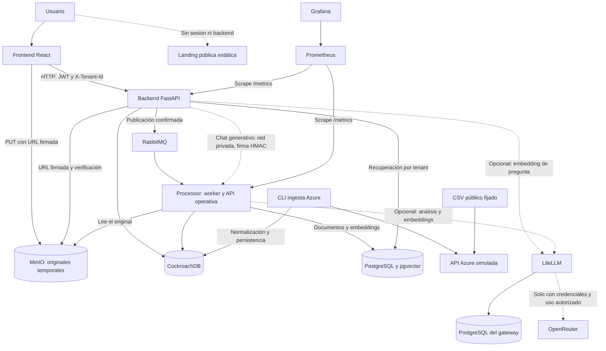
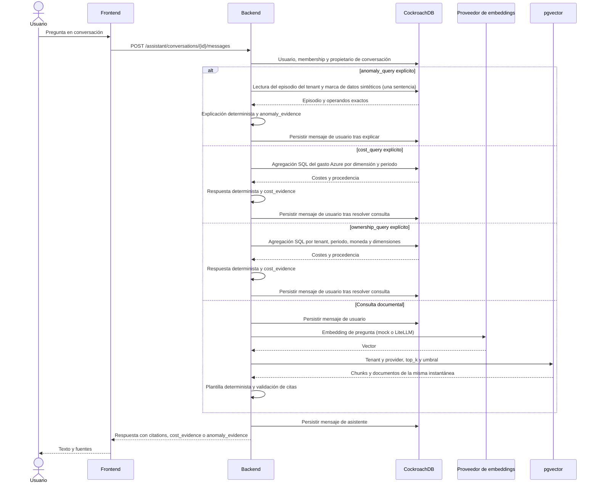
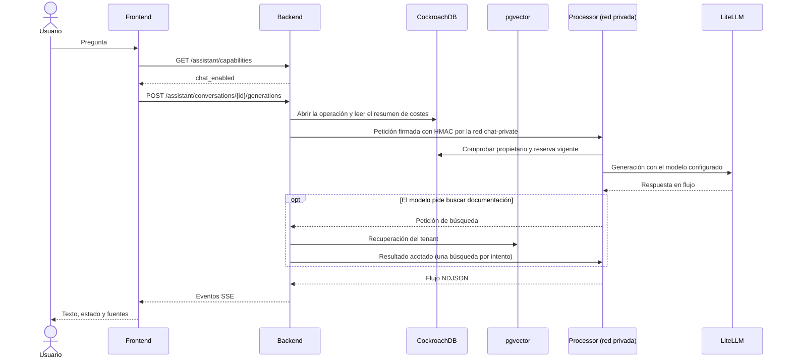
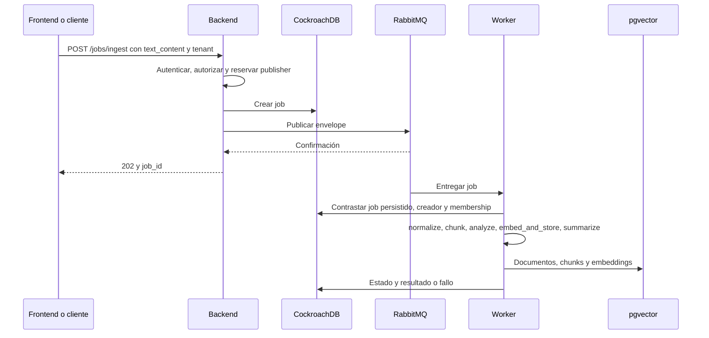
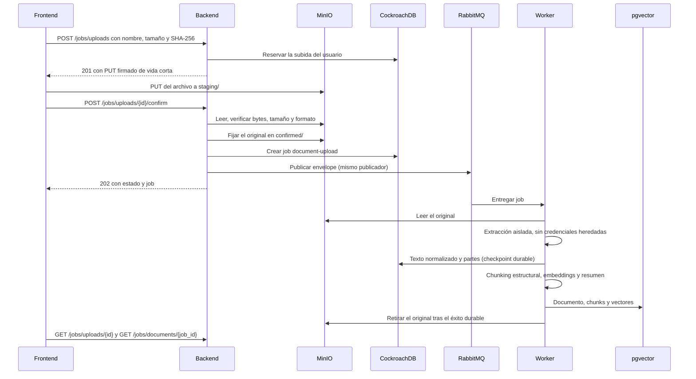
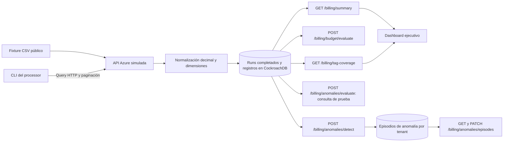
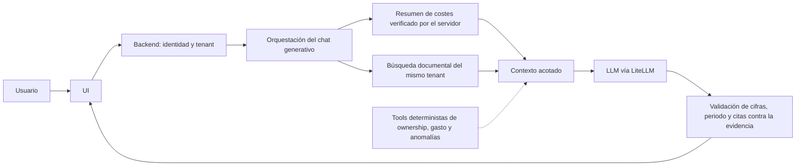
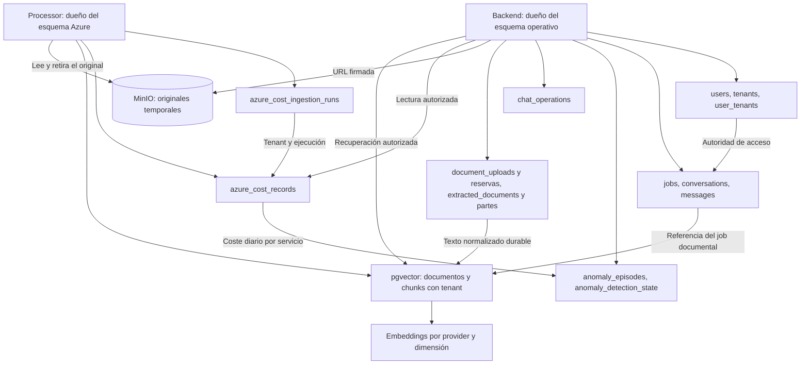
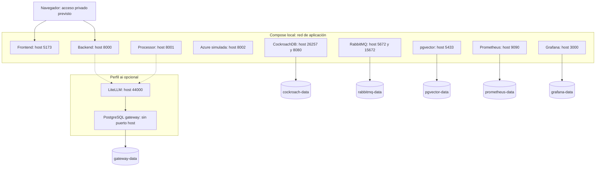
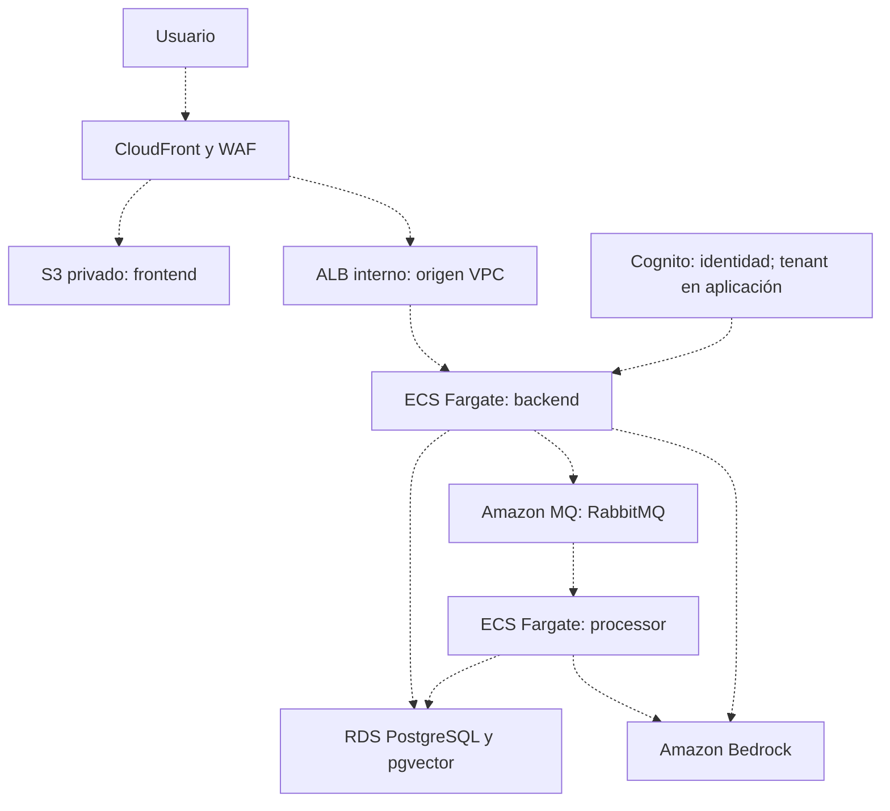

# Arquitectura técnica de Economicon

JUP-060 · [Trello](https://trello.com/c/alMIpBOQ) · Corte de código: **22/10/2026,
develop 03e97ce6** (actualizado en [JUP-138](https://trello.com/c/WvzuP74W/130-jup-138);
el corte anterior era 11/10/2026, a0e9a56). Esta vista sustituye las
descripciones históricas de billing fijo, aislamiento pendiente y citas pendientes.
Describe código integrado; las ejecuciones citadas conservan su fecha, host y SHA.
No certifica que un servidor esté ejecutando ahora esa versión.

## 1. Alcance y lectura

Economicon es un asistente FinOps para Azure con interfaz web, API, procesamiento
asíncrono y recuperación vectorial. El entorno reproducible es una demo con datos
públicos/sintéticos; no conecta a una cuenta Azure real. El chat documental recupera
contexto y devuelve una **plantilla determinista**; las consultas estructuradas
de ownership, de gasto y de anomalías agregan o leen datos mediante SQL y generan
evidencia determinista. Hay además un **chat generativo** integrado (JUP-122,
JUP-123, JUP-132) que el backend delega al processor por una red privada; está
**desactivado por defecto** (`CHAT_ENABLED=false`) y solo se muestra en la interfaz
si el backend declara que está activo. Su modelo recibe un contexto acotado: el
resumen de costes verificado por el servidor y una búsqueda documental del
servidor. Las consultas de ownership, gasto y anomalías no se le exponen todavía
como herramientas (§3.4).

En los diagramas de bloques las flechas continuas describen conexiones implementadas;
las punteadas, capacidades opcionales o propuestas, rotuladas en cada figura.
En las secuencias, las flechas discontinuas representan el retorno de la llamada.
Configuración,
ejecución y aceptación son evidencias distintas. El [registro ADR](adr/README.md)
conserva las decisiones; el [informe JUP-060](evidence/JUP-060-validation.md)
relaciona criterios y comprobaciones. La memoria del TFM mantiene su
[fuente compartida y reglas](memoria/README.md): este documento es referencia
técnica, no una copia de sus apartados.

## 2. Componentes y fronteras

| Componente | Responsabilidad y límite | Implementación |
| --- | --- | --- |
| Frontend | Sesión, tenant, conversaciones y dashboard ejecutivo conectado a billing. Panel de anomalías conectado a los episodios guardados. Subida de archivos a MinIO con URL firmada desde la página de ingesta, y panel de chat generativo que solo aparece si el backend declara el chat activo. Los paneles operativo, de recortes y de recomendaciones siguen en el código sin ruta ni menú (JUP-116). No accede a DB, cola ni claves del proveedor. | [Cliente HTTP](../apps/frontend/src/services/api.ts), [rutas](../apps/frontend/src/routes.tsx) |
| Backend | Autenticación, autorización, costes/presupuesto, episodios de anomalías, publicación de jobs, conversaciones, recuperación/citas, ownership SQL, consultas de gasto, cobertura de etiquetas y salud agregada. También reserva y confirma subidas de archivos (JUP-124) y, con el chat activo, orquesta las generaciones y resúmenes del chat generativo y los delega al processor por la red privada. | [Rutas](../apps/backend/app/api/routes), [acceso](../apps/backend/app/api/dependencies.py) |
| Processor | Worker documental y pipeline LangGraph, con extracción local aislada de los archivos subidos (MD, TXT, PDF, DOCX y DOC, con OCR) y chunking estructural; CLI independiente para costes Azure. API de salud/métricas y, con el chat activo, una superficie privada de chat y resumen en el puerto 8003 de la red interna, solo para el backend y con firma HMAC. AgentRuntime es módulo Python, no servicio de red. | [Pipeline](../apps/processor/app/graphs/pipeline.py), [CLI Azure](../apps/processor/app/run_azure_cost_ingestion.py), [agentes](../apps/processor/app/agents/service.py) |
| MinIO | Almacén de objetos S3 con un bucket privado dedicado para los originales de las subidas: URL firmadas de vida corta, caducidad de `staging/` y retirada del original tras el procesado. Credenciales de servicio separadas de las de administración. Los textos normalizados y los vectores no viven aquí. | [Dockerfile](../infra/minio/Dockerfile), [inicializador](../infra/minio/init.sh), [ADR-0022](adr/ADR-0022-document-ingestion-artifact-lifecycle.md), [runbook](runbooks/document-ingestion.md) |
| API Azure simulada | HTTP posicional, bearer local, paginación y errores reproducibles sobre CSV público. No autentica contra Azure ni representa una factura completa. | [README](../apps/azure-cost-api/README.md), [fixture](../fixtures/azure-cost/README.md) |
| LiteLLM, opcional | Proxy del processor y de embeddings del backend; claves virtuales separadas y DB propia. OpenRouter es el upstream configurado. | [Configuración](../infra/litellm/config.example.yaml), [operación](../infra/litellm/README.md) |
| Shared config | Configuración reutilizable del workspace; no es servicio de runtime. | [Paquete](../packages/shared-config/README.md) |
| Landing pública | Aplicación estática independiente de la interfaz autenticada: sin backend, sesión ni claves, con una demo ilustrativa rotulada como tal. No está en Compose ni en el CD, y su dominio y publicación siguen pendientes de decisión humana. | [README](../apps/landing/README.md), [operación](operations/public-landing.md) |

## 3. Flujos implementados y vertical objetivo

### 3.1 Chat síncrono: recuperación documental, consultas de gasto y ownership y explicación de anomalías

Cuando el mensaje lleva `anomaly_query` (JUP-038), la ruta lee el episodio del
tenant de la sesión con `Database.fetch_anomaly_episode_snapshot` (una sola
sentencia SQL: episodio, operandos exactos y marca de datos sintéticos) y arma la
explicación con el explicador puro
[anomaly_explanations.py](../apps/backend/app/services/anomaly_explanations.py):
texto determinista y `anomaly_evidence` con las cifras exactas y un identificador
reproducible. No usa embeddings, recuperación documental ni modelo generativo, y
solo guarda los dos mensajes cuando la explicación está calculada: un episodio
inexistente o de otro cliente da el mismo 404 y uno que no se sabe explicar da
409, sin dejar nada en la conversación. Es excluyente con `ownership_query` y `cost_query`.
Véase [contrato de la explicación](api/anomaly-explanations.md). La explicación
no se expone como herramienta al modelo del chat generativo (§3.4).

La [ruta de mensajes](../apps/backend/app/api/routes/assistant.py)
(`POST /assistant/conversations/{id}/messages`) no llama al processor ni
a la cola. Cuando recibe `cost_query` (JUP-036), responde con una agregación SQL
del gasto Azure por dimensión y periodo y devuelve `cost_evidence`
([contrato](api/azure-cost-questions.md)); no usa embeddings ni modelo. Cuando
recibe `ownership_query`, usa
[OwnershipQuestionService](../apps/backend/app/services/ownership_questions.py):
agrega costes de ejecuciones completadas por tenant, período y moneda, con
dimensiones permitidas y procedencia verificable. Devuelve `cost_evidence`,
sin embeddings, recuperación documental ni llamada LLM. Los rechazos de la
consulta (409/422) ocurren antes de persistir el mensaje de usuario. La interfaz ofrece un
formulario explícito; no interpreta libremente lenguaje natural en SQL. Véase
[contrato ownership](api/ownership-questions.md). Para la rama documental, [AssistantService](../apps/backend/app/services/assistant.py) muestra
hasta tres fragmentos o indica falta de contexto. La consulta vectorial filtra
tenant y proveedor, ordena por distancia coseno e identificador y limita con
`RETRIEVAL_TOP_K` (1–20, defecto 4). Con LiteLLM el umbral por defecto es 0.6;
mock no aplica umbral por defecto. Con LiteLLM los embeddings requieren
dimensión 1536 (con el proveedor Bedrock de JUP-131, 256, 512 o 1024) y el
mismo modelo que la ingesta: cambiar de proveedor exige reindexar en un almacén
compatible, no mezclar vectores.

[Citas](../apps/backend/app/services/citations.py) valida cada referencia contra
chunks recuperados y tenant; devuelve documento/chunk, título, sección cuando
puede localizarse sin ambigüedad y fragmento. Fallos de embedding/retrieval devuelven 503; referencias
inválidas, 502. Como el mensaje de usuario se guarda antes de recuperar, un
fallo no implica que la conversación quede sin cambios. Las evidencias de
[recuperación](evidence/JUP-022-validation.md) y
[citas](evidence/JUP-025-validation.md) son históricas, no nuevas llamadas de JUP-060.

**Recuperación verificada, contextual e híbrida (JUP-127,
[ADR-0024](adr/ADR-0024-verified-contextual-retrieval.md)).** Con
`RAG_VERIFIED_ENABLED=true` (por defecto `false`) la consulta no usa el índice
heredado sino la generación activa del tenant, que fija el espacio de embeddings
y su configuración; si no hay una generación verificada, falla en lugar de caer
al índice heredado. `RAG_CONTEXTUAL_ENABLED` y `RAG_HYBRID_ENABLED` (también
`false`) añaden contexto determinista al chunk y búsqueda por texto combinada
con la vectorial, y exigen el flag verificado. Con los tres apagados, que es el
valor de Compose, el recorrido descrito arriba no cambia.

**Chat generativo (JUP-122, JUP-123, JUP-132).** Es un recorrido distinto del
anterior y solo existe con `CHAT_ENABLED=true` en backend y processor; con el
valor por defecto `/assistant/capabilities` informa `chat_enabled=false`, las
generaciones responden 503 y la interfaz no muestra el panel.

El backend es el único que puede pedir generaciones al processor: la
superficie privada del puerto 8003 no se publica, exige firma HMAC con nonce y
comprueba en SQL propietario y reserva antes de llamar al gateway. Cada
operación se guarda (`chat_operations`) y puede consultarse, detenerse o
reanudarse (`…/generations/{operation_id}`, `/stop`, `/resume`); el historial
largo se compacta con un resumen (`…/summary`). El alias de modelo por defecto
es `economicon-chat`, que [ADR-0026](adr/ADR-0026-default-chat-model.md)
(Proposed) resuelve a DeepSeek V4.1 Flash por el gateway, sin alternativa de
reserva. Lo que el modelo recibe y puede usar se limita al resumen de costes
verificado por el servidor y a la búsqueda documental; no ejecuta SQL ni
herramientas de ownership, gasto o anomalías. Contexto en
[chat conversacional](continuidad/chat-conversacional.md) y
[modelo único](continuidad/modelo-unico-chat.md). Que el recorrido esté
integrado no acredita calidad generativa extremo a extremo en la demo por
defecto: esa evidencia sigue siendo la de sus informes de evaluación.

### 3.2 Ingesta documental asíncrona

La figura muestra el formulario de texto: `POST /jobs/ingest` exige `text_content`
y `artifact_uri` es solo metadato, sin descarga ni extracción. No hay endpoint
`GET /jobs/{id}`; el estado de una subida de archivo sí se consulta (siguiente
figura). La figura muestra el camino exitoso; publicación rechazada, no enviada o de
resultado desconocido tiene tratamiento en
[jobs](../apps/backend/app/api/routes/jobs.py) y
[ADR-0009](adr/ADR-0009-rabbitmq-publisher-lifecycle.md). No hay transacción
distribuida DB/cola ni outbox; no se promete exactly-once ni reintento sin duplicados.

**Fallos y reintentos del worker (JUP-113,
[ADR-0019](adr/ADR-0019-ingestion-retry-policy.md)).** `POST /jobs/ingest` rechaza con 422 un `source` que el
processor no aceptaría, así que ese trabajo ya no se crea. En el worker, un mensaje inválido, un fallo de
proveedor o un trabajo que rechaza el guardrail de entrada se descartan en una entrega; un fallo no
clasificado se reencola **una vez**, usando la marca `redelivered` de RabbitMQ, y se descarta en la
reentrega con el job en `failed`; y si no se puede leer o registrar el estado del job (base caída), el mensaje
se reencola sin tope, porque descartarlo dejaría el job sin mensaje. La consecuencia que se asume: si pgvector o
los embeddings fallan el tiempo suficiente para los dos intentos (unos 10 s medidos con pgvector parado), los
jobs de ese intervalo quedan `failed` y hay que reenviarlos. Tabla completa en el
[README del processor](../apps/processor/README.md#fallos-reintentos-y-descarte-jup-113).

**Subida de archivos (JUP-124,
[ADR-0022](adr/ADR-0022-document-ingestion-artifact-lifecycle.md)).** La
interfaz también admite MD, TXT UTF-8, PDF, DOCX y DOC, de 1 a 20 000 000 bytes,
un archivo por envío. El binario no viaja por RabbitMQ ni por el backend: el
navegador lo sube a MinIO con una URL firmada.

Solo el servidor decide claves, tenant y autorización. La extracción corre en el
processor con herramientas locales (LibreOffice, Tesseract con OCR
`spa+eng`, parsers de PDF y DOCX) y límites de páginas, tiempo y memoria; si el
aislamiento Linux no está disponible, falla cerrado. El texto normalizado queda
en CockroachDB antes de seguir, de modo que recuperación y citas no dependen de
conservar el binario, y los reintentos reutilizan ese punto de control. El
original se conserva mientras pueda hacer falta recuperarlo y se retira tras un
éxito durable; la caducidad de MinIO solo afecta a `staging/`. Los chunks se
generan de forma estructural y reproducible desde el texto normalizado, sin
llamar a un modelo ([ADR-0023](adr/ADR-0023-deterministic-document-chunking.md),
[runbook de chunking](runbooks/document-chunking.md)). Límites, formatos,
variables y licencias (MinIO y `mc` son AGPL-3.0) en el
[runbook de ingesta](runbooks/document-ingestion.md); los dos ADR siguen en
estado Proposed.

La fase analyze puede usar AgentRuntime/LiteLLM, schema FinOpsResponse y
guardrails. Su entrada contiene source, status y metadatos saneados; no recibe
la pregunta del chat, chunks ni consulta de costes. El mock produce
`insufficient_data`. Esto no acredita una respuesta generativa FinOps
fundamentada extremo a extremo.

### 3.3 Datos de coste y lectura de billing

La entrada comprobable es `python -m app.run_azure_cost_ingestion --tenant-id …
--subscription-id …` desde el processor; el job documental no llama a ese
servicio. La ingesta es idempotente por tenant/suscripción/definición y trata
errores sin registros de coste parciales. Véanse
[flujo Azure](architecture/azure-cost-e2e.md) y
[normalización](architecture/azure-cost-normalization.md).

Billing **sí lee** azure_cost_records de ejecuciones completadas: período UTC
semiabierto, dimensiones permitidas, importes decimales como cadenas y totales
separados por moneda. Rechaza solapamientos ambiguos con 409 según
[ADR-0010](adr/ADR-0010-azure-cost-source-overlap.md).
`savings_identified` es null; no hay ahorro realizado calculado.
`open_ingestions` cuenta todos los jobs del tenant en esta base, pese a su
nombre. Evaluar presupuesto no lo persiste ni envía notificaciones.
La evaluación de anomalías de JUP-030 tampoco guarda nada; los episodios de
JUP-114 sí: «Detectar ahora» aplica la regla diaria de negocio sobre el coste
diario por servicio y guarda episodios con criticidad y estado
([API](api/anomaly-episodes.md), [ADR-0020](adr/ADR-0020-cost-anomaly-episodes.md)).
El panel `/anomalies` los lee, detecta bajo demanda y cambia estados. No hay ejecución periódica ni avisos.

**Datos de demostración y fecha de referencia (JUP-119, [ADR-0021](adr/ADR-0021-demo-cost-data-single-path-and-reference-date.md)).**
Los datos de la demo entran por la misma ruta que cualquier coste: `scripts/demo_dataset.py` genera un CSV con el
formato de exportación de Azure (dataset público con las fechas desplazadas a septiembre de 2026 y series sintéticas,
todo en la ventana del 1 de julio al 30 de octubre de 2026), una segunda instancia de la API simulada lo sirve
(perfil `demo` de Compose) y `scripts/demo_data.py` lo carga con la ingesta del processor, nunca insertando filas.
La consulta agrupa por dos campos (servicio y etiqueta `Project`), así que la demo no lleva grupo de recursos,
centro de coste ni el resto de etiquetas. El «hoy» de la aplicación lo decide un solo servicio del backend,
`COST_REFERENCE_DATE` (sin valor, el día UTC real): las lecturas de coste y los episodios no muestran nada posterior y
el frontend lee la fecha de `GET /billing/reference-date` ([API](api/reference-date.md)).
[Contrato billing](../openspec/specs/azure-cost-kpis/spec.md) y
[consulta SQL](../apps/backend/app/db/database.py).

La [cobertura de etiquetas](../openspec/specs/tagged-cost-coverage/spec.md)
pondera por coste positivo el cumplimiento de cinco etiquetas FinOps, por
tenant, período y moneda. Los ajustes negativos se muestran aparte; sin cargos
positivos devuelve N/D. El dashboard ejecutivo carga el panel bajo demanda.
Es cumplimiento de la política, no calidad demostrada de las etiquetas.
[JUP-068](validation/JUP-068-business-metrics.md) calcula métricas offline a partir
de evidencia declarada; no prueba adopción, ahorro realizado ni un piloto real.

### 3.4 Vertical conversacional: lo integrado y lo pendiente

Las flechas continuas son recorridos integrados que se ejecutan solo con
`CHAT_ENABLED=true` (§3.1); **la única conexión punteada, las tools
deterministas, es el objetivo de integración y no existe todavía.** Los
contratos de
[tools](architecture/finops-agent-tools.md) y
[respuesta/guardrails](architecture/finops-response-guardrails.md) establecen
que la aplicación autoriza y ejecuta: el modelo no elige libremente tenant,
SQL, credenciales o acciones. Hoy el modelo solo puede pedir una búsqueda
documental, que ejecuta el backend, y el servidor valida la respuesta contra la
evidencia autorizada antes de guardarla. Las consultas de ownership, de gasto y
de anomalías siguen siendo formularios explícitos de la ruta de mensajes (§3.1)
y no existe un registro ejecutor de tools FinOps que el modelo pueda invocar.
Ni CI verde ni una prueba del proxy certifican calidad generativa extremo a
extremo; la evidencia de evaluación está en sus informes.

## 4. Que papel tienen RabbitMQ, CockroachDB y pgvector

Es un mapa lógico de responsabilidad/procedencia, **no un ERD de claves
foráneas entre bases**. CockroachDB guarda estado transaccional; pgvector
el índice recuperable; RabbitMQ transporta envelopes y conserva la cola
durable; MinIO guarda solo los originales de las subidas mientras hacen falta,
sin textos normalizados ni vectores. La DB del gateway es independiente: no
almacena costes FinOps.

Según [ADR-0011](adr/ADR-0011-single-owner-per-table.md), backend migra sus
quince tablas (usuarios, tenants y membresías, jobs, conversaciones y mensajes,
episodios de anomalía, operaciones de chat y las de subida y extracción de
documentos) y processor las dos de Azure; cada servicio tiene su registro de
migraciones. Processor también actualiza estados de jobs, pero no es dueño de
su DDL: espera a backend sano después de migrar. El índice vectorial (incluidas las generaciones de embeddings de JUP-127) lo migra
processor, con dimensión obtenida de Settings (JUP-102), sin conversión ni
reindexación automática al cambiarla; backend comprueba la dimensión al iniciar cuando puede consultar la
tabla, sin garantizar readiness del índice si esa comprobación se omite.
No hay commit atómico
entre CockroachDB, pgvector y RabbitMQ ni backup de conjunto demostrado.

## 5. Identidad, tenant y secretos

La API valida JWT propio HS256 (sub/iat/exp, tolerancia 5 s) y consulta al
usuario persistido. `X-Tenant-Id` selecciona una membresía de user_tenants;
no concede acceso por sí solo. Conversaciones/mensajes requieren además
usuario propietario. Documentos/chunks se comparten dentro del tenant.
Worker contrasta envelope con job persistido, creador existente y membresía vigente;
no confía en campos del productor. Roles guardados no equivalen a RBAC completo.
Fuentes: [ADR-0008](adr/ADR-0008-tenant-isolation-boundaries.md),
[sesión](../openspec/specs/demo-auth-session/spec.md) y
[evidencia de aislamiento](evidence/JUP-086-validation.md).

Frontend conserva sesión en localStorage, revalida /me y /tenants y gestiona
expiración/cambio de sesión. CORS usa orígenes explícitos
([ADR-0007](adr/ADR-0007-backend-cors-policy.md)); no sustituye autorización.
La auth demo [ADR-0014](adr/ADR-0014-demo-auth-boundary.md) no acredita IdP,
MFA, revocación ni seguridad de una aplicación pública.

Las credenciales operativas se suministran en runtime, fuera de Git e imágenes;
el simulador Azure conserva valores locales de prueba explícitos. Variables VITE_*
son públicas. Clave upstream OpenRouter y clave maestra quedan en gateway;
backend usa BACKEND_LITELLM_API_KEY de embeddings y processor su clave virtual.
No se publican valores en evidencias.
[ADR-0006](adr/ADR-0006-runtime-secret-boundaries.md) limita CockroachDB
`--insecure` a demo local desechable con development/test y opt-in explícito:
trasladar el host a cloud no amplía esa excepción.

## 6. Despliegue reproducible y propuesta cloud

### 6.1 Topología local declarada

Valores por defecto de [docker-compose.yml](../docker-compose.yml): **9 servicios
base y 5 volúmenes**; ai añade LiteLLM/PostgreSQL/gateway-data (**11 y 6**).
Las cuatro apps publican puerto **sin dirección loopback por defecto**;
las publicaciones de infraestructura sí usan 127.0.0.1. El objetivo privado
requiere configurar bindings/red/firewall del host: Compose por sí solo no
demuestra privacidad. /metrics tampoco exige auth al publicar la API.
La red base no restringe egress. No hay HA: host, bases single-node y cola
son puntos de fallo.

| Dependencia | Referencia fijada en código |
| --- | --- |
| CockroachDB | v24.1.11 por digest |
| RabbitMQ / pgvector | 3-management / pg17 por digest; esos tags no identifican patch por sí solos |
| Prometheus / Grafana | v2.55.1 / 11.3.0 por tag, sin digest |
| LiteLLM / DB gateway | 1.103.2 / postgres:17-alpine por digest |
| Apps Python | python:3.12-slim por digest; requirements usan rangos, no resolución pip completamente fijada |
| Frontend | node:20-alpine por digest; pnpm 9.0.0 y lockfile. CI usa Node 22 |

Los digests completos están en los Dockerfiles de las aplicaciones, Compose y
[Compose gateway](../infra/litellm/docker-compose.yml); no se mantiene otra
lista que pueda divergir. Son versiones del proyecto, no recomendaciones
de versiones actuales. Orden: DB/cola/vector sanos → backend migrado →
processor; processor espera además Azure. Frontend espera backend;
Prometheus espera backend/processor y Grafana espera Prometheus.
Grafana no tiene healthcheck Compose.

[Overlay ai](../infra/litellm/compose.ai.yml) exige gateway sano a ambos
consumidores. Activar solo el perfil no sustituye overlay, providers,
dimensiones ni claves. Seguir los recorridos mock/IA/retorno del
[README](../README.md), con proyectos separados para índices mock y reales.
Frontend sirve con **Vite preview**, no servidor de producción.
Las cuatro apps usan usuario sin privilegios, raíz de solo lectura y tmpfs;
no se extiende esa garantía a toda la infraestructura.
`down` conserva volúmenes nombrados; `down -v` los elimina.
Persistencia ante recreación no equivale a backup/restore.

### 6.2 Evidencia de despliegue

| Fuente | Afirmación soportada | Límite |
| --- | --- | --- |
| [JUP-049](evidence/JUP-049-validation.md) | Smoke histórico 08/09 en DockerServer, tree 1d05259b2db193bded864d7491a238d89e0f524c. | No estado vivo actual; sus cuatro volúmenes preceden a persistencia RabbitMQ. |
| [JUP-050](evidence/JUP-050-validation.md) | Ensayo 01/10 en Windows/Docker Desktop: nueve servicios, smoke 5/5, error con processor parado y persistencia down/up. | No Linux/macOS nuevos, backup/restore o runtime c2995a1. |
| [JUP-108](evidence/JUP-108-validation.md) | Pruebas históricas mock/IA, claves/gateway/persistencia, con upstream sintético y campaña real separadas en su informe. | No chat web generativo completo, nueva ejecución por JUP-060 ni permiso de consumo pagado. |
| [JUP-052](evidence/JUP-052-validation.md) / [PR #73](https://github.com/EconomiconFinOps/tfm-economicon/pull/73) | CD privado integrado en a0e9a56: elegibilidad por CI, agente systemd, releases por SHA y smoke antes de promover. | La evidencia distingue ensayo de recuperación de primera promoción; esta revisión documental no vuelve a inspeccionar el host. |
| [JUP-078](evidence/JUP-078-operational-closure.md) | Gateway dedicado y claves limitadas verificados en su corte del 10/10. | No adopción automática por el CD mock ni nueva prueba upstream o de chat generativo. |
| Revisión estática JUP-060 | Código/configuración disponibles para reproducir. | No inventario vivo, capacidad, HA, RPO/RTO o despliegue final aceptado. |

### 6.3 AWS: arquitectura de referencia y Terraform sin despliegue

Todas las conexiones son **conceptuales**. El usuario confirmó el 10/10 que AWS
forma parte del entregable documental y no se desplegará. El
[esquema AWS completo](architecture-aws.md) incluye correspondencia con el stack,
seguridad, alternativas de acceso, operación, fuentes y límites. La
[plantilla Terraform](../infra/aws-reference/README.md) incorpora recursos,
variables, ejemplos y pruebas simuladas como complemento técnico solicitado.
Terraform es alternativa a CDK/CloudFormation; el pipeline CodePipeline/CodeBuild
del esquema sigue conceptual y no está implementado por la plantilla.

CockroachDB → PostgreSQL, Cognito y Bedrock requieren adaptaciones hipotéticas;
no son capacidades integradas ni nuevas tareas de runtime en JUP-060. Las tareas
ECS están desactivadas por defecto; un apply crearía el resto de recursos con
coste, por lo que ese flag no es un modo de simulación. Solo se validan formato,
esquema y pruebas con proveedores mock, sin plan real, credenciales ni apply.

La [propuesta EC2 del 09/10](planning/aws-deployment-proposal.md) queda como
antecedente histórico: sus preguntas de cuenta/presupuesto, demo y fases
operativas ya no son pendientes para esta entrega. La aceptación documental
no exige recursos, migraciones, URL operativa ni pruebas AWS.

## 7. Por que esta separado asi

| Elección | Justificación, alternativa y límite |
| --- | --- |
| Frontend/API/processor | Aislar presentación, autoridad de acceso y trabajo lento. Hacerlo todo en la petición acoplaría latencia/fallos; escalar workers es posibilidad, no benchmark. |
| CockroachDB + pgvector | Compatibilidad con estado operativo e índice existentes. [ADR-0013](adr/ADR-0013-pgvector-retrieval-baseline.md) explica ranking exacto; no se acredita superioridad de Cockroach frente a PostgreSQL ni necesidad de SQL distribuido. |
| RabbitMQ | Publisher confirmado y consumidor asíncrono según ADR-0009; exige tratar duplicados e incertidumbre DB/cola. |
| API Azure simulada | [ADR-0001](adr/ADR-0001-azure-cost-api-simulation.md): HTTP, paginación y errores sin tenant real; CSV directo no probaría ese contrato. Datos limitados. |
| LiteLLM/OpenRouter | [ADR-0002](adr/ADR-0002-litellm-openrouter.md): concentrar credenciales/políticas; su aceptación no implica calidad ni gasto autorizado. [ADR-0017](adr/ADR-0017-backend-query-embedding-own-key.md) separa clave del backend y fija compatibilidad de embeddings. |
| Compose local | [ADR-0015](adr/ADR-0015-local-compose-deployment-boundary.md): topología reproducible; no selecciona Kubernetes, HA o hosting productivo. |

Se conservan estados de los ADR originales, incluidos los Proposed:
documentar o integrar no ratifica decisiones. Esta consolidación no introduce
una decisión arquitectónica nueva.

## 8. Observabilidad, entrega y límites

Prometheus scrapea backend/processor cada 15 s. Grafana aprovisiona dashboards
y alerta de fallos de ingesta, **sin receptor externo**. El contador mide
marcas de fallo persistidas, incluidos reintentos, no jobs únicos: con el tope de JUP-113, un job con un
fallo no clasificado suma como máximo 2.
Los logs JSON con request_id y los estados de job ayudan al diagnóstico;
no se acredita stack central de logs ni trazado distribuido completo.
Fuentes: [monitorización](../apps/monitoring),
[ADR-0005](adr/ADR-0005-prometheus-grafana-metrics.md).
/health/status exige auth; diagnóstico de proveedor es explícito.
Salud HTTP de processor no confirma progreso del worker (worker_status puede
ser unknown). Calidad offline del asistente se documenta por separado en
[JUP-067](validation/JUP-067-metrics.md) y [JUP-070](validation/JUP-070-evaluation.md);
sus resultados se ven en un dashboard de Grafana aparte, alimentado desde el esquema
`evaluation` de PostgreSQL ([guía](validation/evaluation-dashboard.md),
[ADR-0022](adr/ADR-0022-assistant-evaluation-results-in-grafana.md)).
Ese dashboard muestra también tres indicadores medidos para la memoria (calidad de la detección de anomalías, coste de IA facturado frente a estimado, y frescura y reconciliación de los datos de coste): los mide `tools/memory-indicators.py`, que consulta al detector, al gateway de IA y a OpenRouter y escribe informes versionados que `evaluation-dashboard:load` carga como cualquier otro; Grafana no accede a la base del gateway ([nota](continuidad/indicadores-memoria.md)).

[CI](../.github/workflows/ci.yml) ejecuta gobernanza/OpenSpec, pruebas y sintaxis
de tres servicios Python, lint/test/build/typecheck frontend.
[Reviews](../.github/workflows/pr-reviews.yml) aplica el proceso JUP.
El [workflow CD](../.github/workflows/cd.yml) reutiliza CI y publica elegibilidad
para el SHA de develop. El [agente privado](deployment/dockerserver-cd.md) consulta
cada cinco minutos, construye una release aislada, fuerza puertos a loopback y
ejecuta smoke antes de promover; state.json/journal acreditan despliegue real.
Este CD usa nueve servicios en modo mock y datos desechables; no incorpora
automáticamente el gateway dedicado de JUP-078 ni es un despliegue productivo.
No se deduce despliegue de sus checks. Rama JUP → PR a develop → revisión y
validación separadas → integración según [CONTRIBUTING](../CONTRIBUTING.md).
El [plan de pruebas críticas](testing/critical-flows.md) conserva las ejecuciones
y limitaciones de JUP-054; esta entrega no las presenta como pruebas nuevas.
El detalle académico DevOps corresponde al apartado f/JUP-111 y no se reescribe aquí.

Quedan por acreditar el vertical generativo conversacional, la cobertura de datos
y aceptación del MVP completo. El despliegue privado y su recuperación conservan
la evidencia fechada de JUP-052; no se reejecutan para esta documentación. La
memoria incorporó el apartado d el 10/10 y tiene su propia versión y revisión
registradas en la [evidencia de entrega](evidence/JUP-060-validation.md). Los enlaces permiten revisar afirmaciones
sin convertir esas pendientes en resultados.
