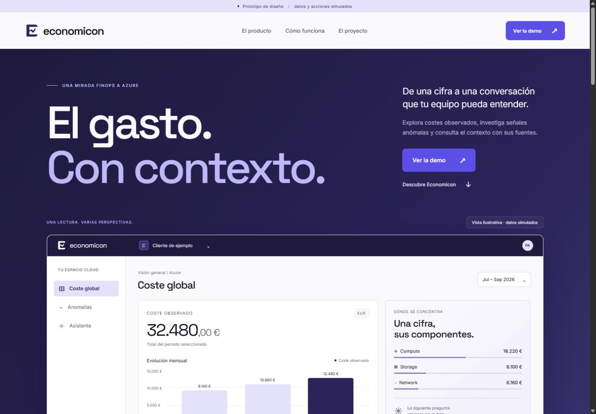

# Evidencia de la landing pública — JUP-089

Verificación local: 19/10/2026. [Tarjeta](https://trello.com/c/fD7nJKRl) · [OpenSpec archivado](../../openspec/changes/archive/2026-10-19-jup-089-public-landing/). Rama feat/JUP-089-public-landing; base evaluada f444ba11e38203b6cfd645a098fd9946d55955e3 más diff de trabajo. Los archivos nuevos no se atribuyen al SHA base. Pruebas propias del liderazgo y evaluaciones independientes R1 conservadas; reevaluación R2 técnica favorable y funcional local favorable, con criterios completos públicos pendientes. Paris aprueba el cierre local y autoriza el archivado, commit y push el 19/10/2026; la aprobación no acredita despliegue público ni reviews humanas.

## Resultado local y límites

App estática independiente, sin cambios al frontend privado, autenticación o API, ni dependencias de producción nuevas. Siete secciones y recorrido aprobados. Datos, fuente, respuesta y acciones ilustrativas rotulados; no se promete Azure conectado, causa demostrada, previsión, ahorro o vídeo.

El diseño visible fue aprobado por Paris el 19/10/2026 según comunicación del liderazgo. Se conservan fuentes, logos, composición y recorrido. Correcciones ordinarias autorizadas: coral→lila/índigo en la candidata de anomalía (ADR-0012 y frontend-brand-identity), contraste de textos secundarios/foco/índice y orientación ARIA según disposición de pestañas. La aprobación estética no sustituye aceptación de publicación ni reviews humanas.

## Criterios oficiales facilitados por liderazgo el 19/10

| Criterio de la tarjeta | Evidencia/resultado | Pendiente |
| --- | --- | --- |
| Dominio y renovación | Configuración acepta origen HTTPS explícito; sin origen el artefacto es noindex | Elegir/aprobar dominio o subdominio, titular y responsable; no se ha registrado nada |
| HTTPS y ausencia de secretos/datos internos | Lista cerrada de archivos, symlinks rechazados, huellas verificadas y pruebas de rutas privadas; sólo datos ilustrativos | Certificado, HTTP→HTTPS y cabeceras en dominio público; loopback HTTP no los acredita |
| Responsive y accesibilidad básica | 1440/390/320 sin overflow; menú, tabs con teclado, diálogo/cierre/Escape/retorno de foco; 15 muestras de contraste cumplen su umbral; imágenes con alt y controles con nombre | No auditoría WCAG completa ni dispositivos físicos; preferencia reduced-motion no emulada |
| Copy respaldado y simulación visible | Composición aprobada, rótulos y límites de coste/candidata/fuentes; cuatro nombres sin cargos inventados | Destino de demo real aún no conectado |
| Rendimiento, accesibilidad y SEO medidos | 230138 bytes en 14 archivos, mediana HTTP loopback 1,41ms en 5 muestras; contraste y estructura DOM medidos; metadatos/local-noindex y origen de prueba cubiertos | Sin Lighthouse/FCP/CLS/CWV ni medición del dominio final; no equivalen a tiempos de usuario |
| Enlaces, vídeo si existe, metadatos y404 | Navegación de secciones, licencias/recursos servidos con hashes, título/description/OG/favicon/robots/sitemap y404 HTTP+visible | No hay vídeo: no se inventa; URLs definitivas dependen de origen aprobado |
| Deploy y rollback | Build reproducible, _headers generado desde política compartida y [manual de operación](../operations/public-landing.md) | Propuesta de hosting no aprobada, sin despliegue ni rollback público ejecutados |
| PR revisada, CI y evidencias | Checks locales indicados abajo, job CI adicional con permisos/acciones existentes | Archivo autorizado ya realizado; corrección del contrato CI local comprobada, evaluación afectada y nueva CI remota pendientes, además de PR/reviews humanas y publicación pública |

## Pruebas y mediciones

[Datos compactos](JUP-089/measurements.json). Windows, Node24.17.0 (contrato Node22+, CI Node22), pnpm9.0.0 y OpenSpec1.8.0. Instalación frozen-lockfile correcta; 612 paquetes reutilizados, sin dependencias nuevas de producción.

| Comando | Resultado |
| --- | --- |
| corepack pnpm jup:check:all | 10 changes enlazados, incluido JUP-089 |
| corepack pnpm pr:check:test | 104 PASS |
| corepack pnpm ci:check:test | 19 PASS, incluido job landing |
| corepack pnpm repository:governance:test | 15 PASS |
| corepack pnpm openspec:validate | 82/82 PASS |
| corepack pnpm test --filter=@finops/landing | 7 PASS, 0 omitidas |
| corepack pnpm build --filter=@finops/landing | PASS, artefacto estático |
| corepack pnpm lint --filter=@finops/landing | PASS |
| corepack pnpm jup:cleanup:check | PASS |

Las suites/build de producto se limitan a la nueva app afectada, según alcance aprobado. Se ejecutan los controles locales obligatorios aplicables y no se repiten baterías Python/RAG/frontend ajenas: no se alteran sus archivos ni dependencias; el lockfile sólo añade un importer vacío y la instalación congelada conserva resolución. Los jobs completos de CI remota siguen pendientes de publicación, no se declaran ejecutados localmente.

Riesgos focales cubiertos: archivos privados, origen inválido, symlinks, build fallido conserva salida válida, integridad de bytes, MIME/HEAD/ETag, rutas desconocidas/traversal/métodos y404 real. Primera ejecución tras añadir _headers: 6 PASS/1 FAIL por orden erróneo del array esperado; se corrigió el orden exacto sin debilitar aserciones y las siete pasan. Medición de contraste detectó índice inactivo2,86:1; corregido y repetido con15/15 muestras conformes. Se conservan los fallos originales en la evidencia de trabajo del liderazgo.

El navegador de comprobación no expone tiempos de pintado ni emulación de reduced-motion. Se midió HTTP/tamaño por separado sin presentarlo como renderizado de usuario. La regla reduced-motion tiene scroll auto y animación/transición none; está comprobada estáticamente, no como preferencia emulada. Se ha elevado este límite al liderazgo y no se marca un PASS público o de auditoría completa.

## Evaluación independiente y corrección R2

R1: revisión técnica REVIEW_FAIL por integración Turbo (P2), validación funcional con evidencia local favorable y dictamen global NEEDS_CONTEXT por criterios públicos completos pendientes. Se conservan los informes originales y su atribución en [review.md](../../openspec/changes/archive/2026-10-19-jup-089-public-landing/review.md). El control independiente al retorno fue conforme antes de corregir. No acredita aislamiento técnico ni ausencia de transitorios; se preserva el intento denegado de Turbo de crear un log, sin escritura efectiva observada.

El arreglo R2 declara SITE_ORIGIN/LANDING_OUT_DIR y PORT de dev en la configuración específica de landing. El hash cambia con origen/salida/puerto y el build desactiva su caché para no restaurar artefactos en un destino relativo distinto del externo solicitado. No cambia HTML/CSS/JS ni los bytes del artefacto local. Pruebas afectadas:28PASS (7landing,19CI,2planesTurbo). Tres builds reales desde la raíz verifican canonical con dos orígenes sintéticos distintos, ausencia del origen anterior, salidas externas y regreso a noindex con el mismo manifiesto de artefacto e9393f135b66bc8af7f6b8c6f7f988b5d31d1641d0edd9a8ccbac0ce46c0a7f0. El dev raíz respondió200 en el puerto temporal solicitado41793 con origen y salida externos correctos; servidor retirado. El primer comando de build tenía el argumento cache-dir mal formado por PowerShell; su fallo original se conserva y no es defecto de producto.

R2 independiente: REVIEW_PASS técnico; el Revisor ejecutó21pruebas afectadas (2Turbo y19CI), dio por resuelto el P2 y confirmó aplicabilidad de su revisión R1 no afectada. Validador: afectado local favorable sin nuevos defectos; ejecutó2pruebasTurbo y dev/build propios con origen/salida/puerto41792, HTTP200/404 y artefacto local idéntico, confirmando expresamente reuso de UI/evidencia R1. NEEDS_CONTEXT global se mantiene por los criterios completos pendientes. Informes y huellas conservados en review.md. Los dos controles independientes al retorno sobre las mismas referencias originales R2 fueron conformes antes de este cierre documental. No sustituyen aprobación humana, CI o comprobaciones públicas.

## Vistas reales de la implementación

[Móvil320](JUP-089/mobile-320.jpg) · [404 móvil](JUP-089/404-mobile.jpg). Las dimensiones CSS de prueba pueden diferir de los píxeles codificados por scrollbar/escalado de captura. Comparación visual con la maqueta aprobada, sin afirmar identidad de píxeles ni puntuación estética objetiva.

## Participación y cierre

Roles propuestos por la tarjeta: Paris liderazgo, Víctor pairing, Alejandro revisión y Lucía validación. No se acredita participación por asignación. No se ha reutilizado HTML/CSS/JS de PR106; los binarios de marca/fuentes conservan su atribución. No existen aún las dos reviews humanas de esta entrega ni permiso de merge.

## Corrección del contrato CI posterior al archivo — 19/10/2026

PM archivó y publicó481b4cffaf7f67607068246455834af59c14b4d8 con autorización de Paris. En el [run39268057889](https://github.com/EconomiconFinOps/tfm-economicon/actions/runs/39268057889), PM identificó2fallos del jobOpenSpec en evaluation-dashboard:test, entre1842casos remotos/1skip. No es un fallo demostrado del UI. La clase CiWorkflowTests se reprodujo antes de editar:2FAIL/2PASS. Se conserva la salida adversa y el log remoto íntegro.

Se actualiza únicamente el literal CI_BLOCK_TODAY para incluir la comprobación Turbo ya obligatoria, después de ci:check:test. Las comparaciones completas de orden/igualdad, unicidad y sangría quedan intactas; no se elimina ni se debilita ningún test o paso CI. Comprobaciones propias posteriores: python -B -m unittest discover -s scripts/tests -p test_evaluation_scripts.py -v:16PASS; node --test tools/ci-workflow.test.mjs:19PASS. Estas35pruebas focales no equivalen a una ejecución nueva de los1842casos ni a CI remota.

Producto, fuentes de UI, artefacto público, workflow y dependencias permanecen idénticos a481b4cf. HEAD481b4cf más delta local del fix, misma rama y basef444. Revisión/validación independientes de este delta y nueva CI remota PENDIENTES. Los dictámenes locales anteriores conservan su candidato/fecha; no se usan como aceptación automática del arreglo. Archivo/commit/push previos no autorizan crear PR ni desplegar.

## Reconciliación de PR142 con develop — 20/10/2026

La información histórica anterior conserva su corte. PM confirma que el fixCI
fue evaluado y publicado como a5a3e9f1c87a89142c8f7dc52883a126f5cc55d6 y que
PR142 permanece Draft, con CI39278498235 y SQL39278498254 correctas sobre ese
SHA. Paris autoriza ahora reconciliar con develop88a6ce4c8a6c523c061e82a0a1f63f495f5db8ec,
evaluar independientemente el efecto y subir el resultado conservando el borrador.
No autoriza despliegue ni cambios de participantes, Trello o merge.

La composición local anterior al commit conserva los20 archivos de la landing,
su diseño, configuración y dependencias originales. Se verifica la igualdad de
2177 archivos entrantes fuera de nuestra aportación; el único conflicto es el
índice documental, resuelto conservando ambas filas. Cambios propios de contenido:
docs/continuidad/README.md, docs/continuidad/landing-publica.md y esta evidencia.
Ningún cambio correctivo en chat, RAG, frontend privado o configuración entrante.

Comprobaciones propias nuevas: instalación con lockfile congelado;104pruebas de
política PR,19CI,15gobernanza,7landing,2planesTurbo y16contrato CI de scripts,
todas favorables (163en total). OpenSpec83elementos y9changes activos correctos.
Build y lint de landing favorables. Dos compilaciones reales desde la tarea raíz
respetan origen y salida externos; modo local14archivos/230138bytes y modo con
origen HTTPS sintético14/230395bytes. El manifiesto local es idéntico al de R2:
e9393f135b66bc8af7f6b8c6f7f988b5d31d1641d0edd9a8ccbac0ce46c0a7f0.
Servidor creado desde ese artefacto en puerto efímero propio: home200, desconocida404,
ruta privada404, HEAD200sin cuerpo y nosniff; cerrado al finalizar. No son pruebas
de HTTPS público, renderizado de usuario ni conexión con la aplicación auténtica.

Por identidad de fuentes y artefacto se conserva la evidencia visual anterior
con sus límites. Cada evaluador debe confirmar expresamente su aplicabilidad a
esta composición y comprobar de forma independiente el efecto pertinente. Los
informes originales, controles PM y CI del nuevo commit se conservan por separado;
no se presenta CI histórica como ejecución del SHA futuro ni se suman baterías
anteriores como pruebas nuevas. El archivo de OpenSpec se mantiene, sin bootstrap
ni aceptación nueva de dominio/hosting/demo. La validación pública global y las
aportaciones humanas siguen pendientes, por lo que PR142 conserva su borrador.

## Reconciliación y observaciones de las reviews — 21/10/2026

Candidato local: HEAD c22713a2dd070b583c869025dbc63e44d7679647,
merge sin commit con develop bc94a4daea98e97b574d00f019d347fc61c2f915.
El índice de continuidad conserva ambas aportaciones. No se modifican los
archivos entrantes de memoria, indicadores o Grafana ni el frontend privado.
No hay SHA nuevo ni CI del delta local.

Se leen las tres reviews suministradas por el liderazgo: revisión complementaria,
validación por criterios y aprobación limitada al alcance local. Cambios:
enlaces reales a documentación y repositorio; pie sin identificador interno;
diálogo que separa integrado, simulado y pendiente; pruebas HSTS con/sin origen.
El diseño, marca, fuentes y recorrido simulado se conservan. Una prueba nueva
reprodujo la ausencia de enlaces antes del arreglo (8PASS/1FAIL). Después pasan
9/9 casos de landing, lint y build desde la raíz. Los errores iniciales de
permisos de sockets y ruta temporal son preparación del entorno, no defectos.

El control Node conjunto de Turbo, política PR, CI, gobernanza y scripts da
140/140 PASS sin omitidas. OpenSpec88/88, las10 trazas activas e higiene son
favorables. No se repiten campañas de modelos, SQL o suites de producto ajenas.
Los artefactos finales contienen14 entradas de manifiesto: local231052bytes,
origen HTTPS sintético231324bytes. SHA256 de build-manifest.json local:
8a475d9747d6161c3fbe1e2b673f075ef26e916e86ece7404dfaf1932442a502;
con origen:31f3c24c928b8411de9f72cc2695b2452cf86df3f6b0070a2ab53913e4e24451.

### Mediciones y navegación afectadas

Lighthouse13.5.0, Node24.17.0 y Edge headless, una ejecución por perfil sobre
loopback con origen sintético; no son medidas del dominio público ni estadísticas
de campo. [Resultados compactos](JUP-089/measurements-20261021.json).

Reproducción: instalar lighthouse@13.5.0 en un directorio temporal ajeno al
repositorio y ejecutar su CLI sobre la preview del artefacto con origen:
`lighthouse http://127.0.0.1:49143/ --preset=desktop --only-categories=performance,accessibility,seo --output=json --output=html`.
Usar Edge/Chrome headless, sin extensiones, y registrar versión/entorno.
Para móvil, omitir preset y establecer screenEmulation390x844, DPR1.
La ejecución original bloqueó navegación a github.com y desactivó informes de
errores; los enlaces sólo se inspeccionaron, no se visitó el repositorio.
Los informes originales completos se conservan con la entrega del liderazgo;
no se sustituyen por este resumen ni se espera identidad de tiempos al repetir.

| Perfil | Rendimiento | Accesibilidad | SEO | FCP | LCP | CLS |
| --- | --- | --- | --- | --- | --- | --- |
| Escritorio | 100 | 100 | 92 | 404ms | 484ms | 0,00355 |
| Móvil390 | 97 | 100 | 92 | 1654ms | 2404ms | 0,00309 |

La primera medida local detectó dos textos de tabs con contraste4,2:1. Se retiró
sólo su opacidad secundaria, conservando el color; ambas auditorías finales pasan
contraste. El SEO restante es la consulta de robots.txt bloqueada por la CSP del
auditor. HTTP directo devuelve200 y el contenido esperado; no se relaja
connect-src none para conseguir otra puntuación. Sin origen, noindex es deliberado.

El perfil móvil se lanzó con force-prefers-reduced-motion y se inspeccionó la
regla CSS que elimina movimiento. No se leyó la preferencia efectiva de ese
proceso ni se acredita una prueba interactiva completa con emulación.
El navegador normal conserva su preferencia habitual.

Comprobaciones de navegador1440/390/320: sin desbordamiento horizontal; tabs
verticales con arriba/abajo y Home/End; horizontales con derecha; menú y diálogo
con Escape/retorno de foco; diálogo de alcance legible en320. Se comprobaron los
href reales sin navegar a servicios del proyecto. [Escritorio](JUP-089/desktop-20261021.png),
[móvil320](JUP-089/mobile-320-20261021.png) y
[alcance móvil](JUP-089/scope-320-20261021.png).

HTTP propio: home200, HEAD200 sin cuerpo, desconocida404, .env/manifest/_headers404
y POST405; cabeceras restrictivas intactas. /404.html directa conserva200, según
decisión documentada. La reversión local restituye el SHA256 de portada
65bd5a69ef4896099891c0f06e1ee3d24a194b6ecaec71746f6ad55cc432edbf.
El [manual](../operations/public-landing.md) permite repetir activación y reversión
de configuraciones; no acredita un rollback público.

### Pendientes reales de este corte

Evaluaciones independientes del candidato fijo y CI del futuro commit, aún no
realizados en este corte. Los dictámenes anteriores no aprueban automáticamente
estos cambios. Roles efectivos: Paris liderazgo, Víctor pairing, Alejandro
revisión, Lucía validación. Las revisiones locales no sustituyen su participación;
un push posterior requiere revalidación humana afectada.

No hay vídeo aprobado en las fuentes suministradas: no se inventa enlace.
Dominio/titular/renovación, alojamiento, HTTPS/despliegue público y destino real
de demo siguen pendientes de decisión. Propuesta: aprobar un proyecto estático
del equipo y su origen antes de publicar; conservar mientras la demo ilustrativa.
No se declara aceptación pública completa ni autorización de publicación.
